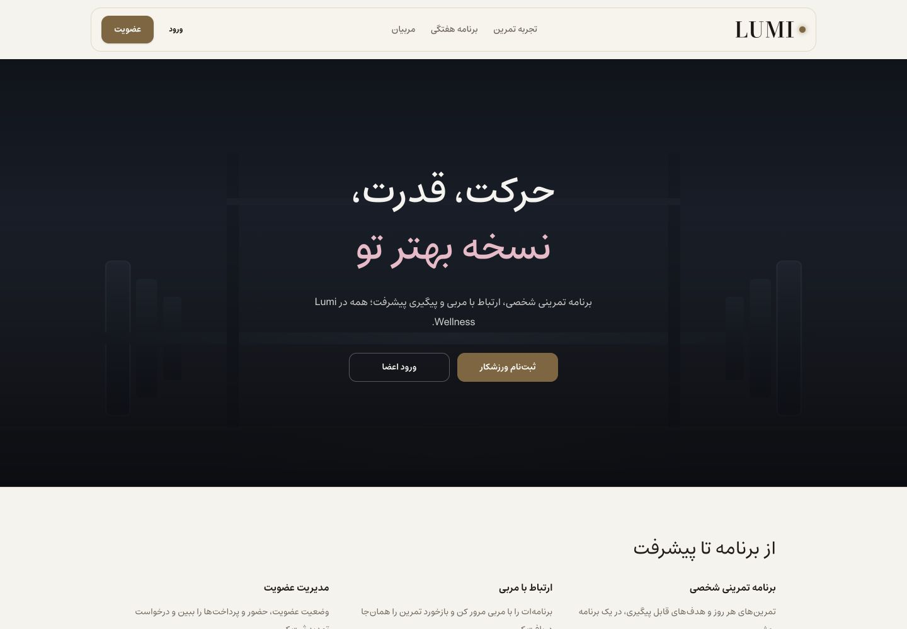

# Deployment readiness review — 10 November 2026

The repository passes its local release checks after targeted fixes. Public deployment still needs a provisioned persistent backend, its real HTTPS API origin, and a matching Vercel project. No public deployment, production migration, push or merge was performed.

## Changes and findings

| Priority | Finding and effect | Resolution |
| --- | --- | --- |
| P1 | Private Next page fetches/prefetches entered the generic service-worker cache branch; reset links could also be cached. | `apps/web/public/sw.js` V4 excludes private fetches, authorization/RSC requests, and private/no-store responses. Generic data reads are excluded; public navigation and static assets retain offline support. Activation removes only old Lumi caches. |
| P1 | `/health` returned success with a missing or stale database. | `/ready` checks SQL connectivity and, in production, the installed Alembic revision. Empty/stale databases return a generic 503; migrated databases return 200. Docker probes `/ready`. |
| P1 | Production deliberately avoids demo seeds but had no first-administrator workflow. | `python -m app.bootstrap_admin` validates identity/password, checks migrations, hashes the password, creates an active admin and refuses an existing account. Secrets never appear in CLI arguments or diagnostics. |
| P2 | The daily revenue view made 30 payment queries; the monthly view made one per month. | One range-bounded scalar-column query feeds chronological zero-filled buckets. Tests verify query count, totals, pending-payment exclusion and future-window exclusion. |
| P2 | The landing page promised automatic renewal and showed fictional coach statistics. | Copy now describes renewal requests. The minimal layout removes duplicate cards, unsupported ratings and decorative icons inside its primary buttons. The sample weekly schedule is explicitly labelled as a sample. |
| P2 | Open Graph used a fixed domain and an SVG social image. The build did not validate the frontend metadata origin. | Open Graph resolves against `NEXT_PUBLIC_APP_URL`; the existing source artwork is converted to PNG. Both frontend and API origins are now deployment build requirements. CI runs a deployment-mode, real-API build. |
| P2 | A local production worker kept serving old development CSS/chunks, obscuring edits. | Development unregisters the local Lumi worker and clears only its caches. PWA remains enabled in production. Query devtools require explicit development opt-in; Next dev badges are hidden. |
| Requested UI | Remove the promotional badge, button stickers, visible scrollbar and unwanted zoom; fit the app to its screen. | Landing CTAs are text-only; the badge is removed. Scrollbar tracks are hidden while scrolling works. Portal minimum height uses the dynamic viewport. The viewport starts at scale one, declares no user zoom and covers safe areas; mobile inputs remain at least 16px. |

The viewport zoom setting is the user's explicit preference. Some browsers may override zoom restrictions. This review does not certify complete accessibility compliance, physical iOS keyboard behavior or real-device gesture behavior.

## Visual review

Captured through the Codex in-app browser with the actual local API and an isolated seeded development database. Final landing measurements were 390/390 and 1440/1440 viewport/document width, zero SVG icons in the two main CTA links, and `scrollbar-width: none`. Initial captures showing a loading boundary or old CSS were rejected. Temporary viewport overrides were reset and the verified app preview was left open.

1. **Public landing, mobile — healthy.** Clear title, short introduction, two text actions and no horizontal overflow. Promotional badge and floating demo-stat card are gone.

2. **Member login, mobile — healthy.** Form, recovery link and primary action fit the screen. Existing input/reveal icons retain their functional purpose. Demo account controls in this capture are development-only; the real-API E2E suite uses production-built frontend servers.

3. **Member notifications, mobile — healthy within the checked flow.** Real seeded notifications render without horizontal overflow or a visible scrollbar. Functional navigation and notification controls remain. No notification was deleted by the visual review.

4. **Public landing, desktop — healthy.** The same content fits a 1440px viewport; whitespace and text hierarchy replace repeated marketing cards. A final inline `dir=ltr` span keeps the two-word brand name together after this screenshot checkpoint.

## Verification

| Check | Result |
| --- | --- |
| Web unit tests | 253 passed, 34 files |
| Backend tests | 213 passed; 4 existing expected failures; 5 dependency/test-key warnings |
| Mock browser suite | 112 passed on mobile and desktop |
| Real API browser suite | 34 passed on mobile and desktop |
| TypeScript and ESLint | Passed |
| Deployment-mode Next build | Passed with mocks false and validation-only HTTPS API/app origins |
| Database migration probes | Empty database → 503, upgrade head → 200, stale revision → 503; no demo seeds in production |
| Bootstrap probes | One active admin created, duplicate refused, invalid passwords rejected without exposure |
| Revenue query evidence | Daily 30 → 1; monthly 6 → 1 payment aggregation queries; exact amount/filter tests passed |
| Diff whitespace | Passed |

The first mock-suite run had one existing test race: the measurement ran before a submit button was visible. The test now waits for that visible control; the complete rerun passed. The first worker regression run reproduced eight privacy/policy/activation failures; all nine cases passed after the worker fix. Four metadata-origin tests failed before the guard change and passed afterward.

The real API suite covers member and staff logins, account CRUD/roles, membership/payment operations, coach programs, exercise completion and saved sets, readiness/attendance, profiles/branches, persistent messages and administrator approval of renewals. Existing authorization/ownership backend tests were rerun. The review is a scoped fullstack release pass, not an exhaustive penetration test.

## Remaining release prerequisites

- Provision the persistent backend and a real API HTTPS origin; configure secrets, CORS and SMTP; apply migrations and bootstrap the controlled administrator on the destination.
- Create/import the `lumi-wellness` Vercel project and set both public origins for Preview/Production. The connected account currently contains three unrelated projects and no matching Lumi project.
- Verify external TLS/CSP/CORS, SMTP password resets and backups against that actual destination. Use the exact controlled preview hostname allowlist.
- Operate one backend process/replica for this release. Shared rate limiting and PostgreSQL rollout are separate work; no PostgreSQL driver or production database validation is claimed.
- Confirm operator contact/social destinations and legal copy. Historical Lighthouse figures in README are not new measurements. This pass establishes query-count improvements, not a new production Lighthouse score.

Hosted Graphify was not exposed by this session's tool inventory, so relationships were checked directly in current source and tests. It could not independently verify this review. No Graphify setup or local graph rebuild was attempted. MagicPath CLI preflight reported unauthenticated; no canvas component was imported or edited. Product Design guided the visual review; Vercel deployment guidance guided the build and release sequence.

Docker's configuration was updated, but the local Docker daemon was unavailable, so image construction was not verified. Production migration/bootstrap behavior was verified through isolated local processes instead.

Follow [the deployment runbook](DEPLOYMENT_RUNBOOK.md). Changes are isolated on `codex/deployment-readiness`; unrelated `.serena` deletions, generated Next declaration changes and earlier untracked screenshots are excluded from the task commit.
