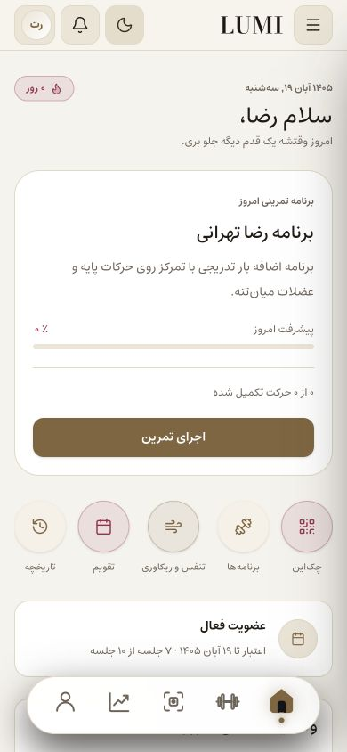
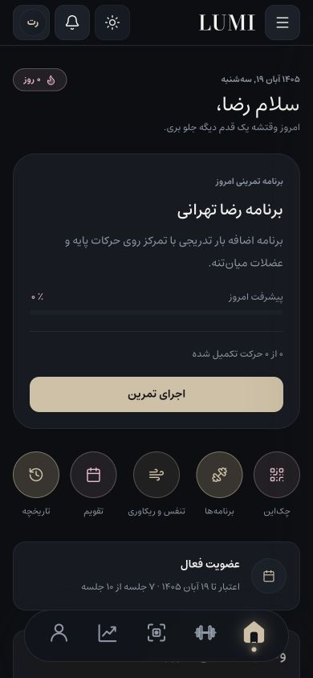
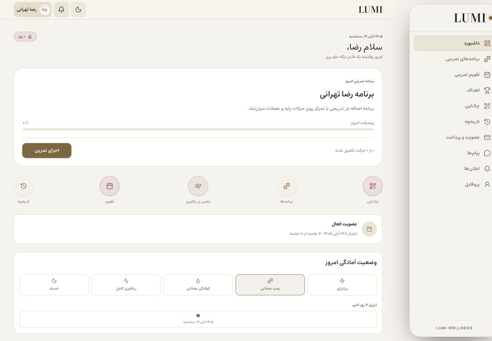

# Today's workout card — 10 November 2026

The athlete dashboard's featured workout card used an always-dark gym backdrop, fixed 270px artwork height, absolute content and a large shadow. It did not adapt to the light theme and its CTA still contained a decorative play icon.

The card now reuses `TwilightCard` with the theme's card surface, border, foreground and muted text tokens. Content flows at its natural height; long titles wrap. A slim progress indicator uses the personal-data blush token, and the sand/bronze CTA has a text-only label. The routine, modal, completion calculations and callbacks are unchanged.

Verified in the in-app browser at 390px and 1440px: no horizontal overflow; the card changes between white in light mode and the shared dark-card surface in dark mode; the main CTA contains zero SVG icons. TypeScript and ESLint passed. No new unit tests were added for this reversible presentation change.

The first screenshot after the edit still showed the old hot-reloaded page; it was rejected and replaced after a refresh. The baseline is saved in `before.png`. The user's original light preference and normal browser viewport were restored. Hosted Graphify remains unavailable in this session; the current source and existing design system were used directly.
